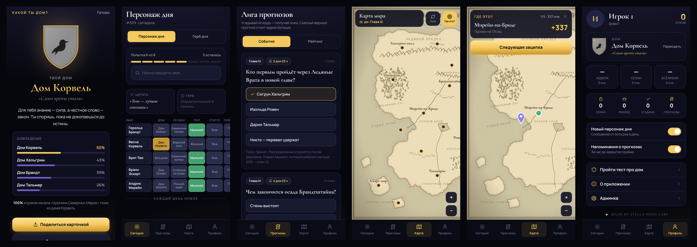
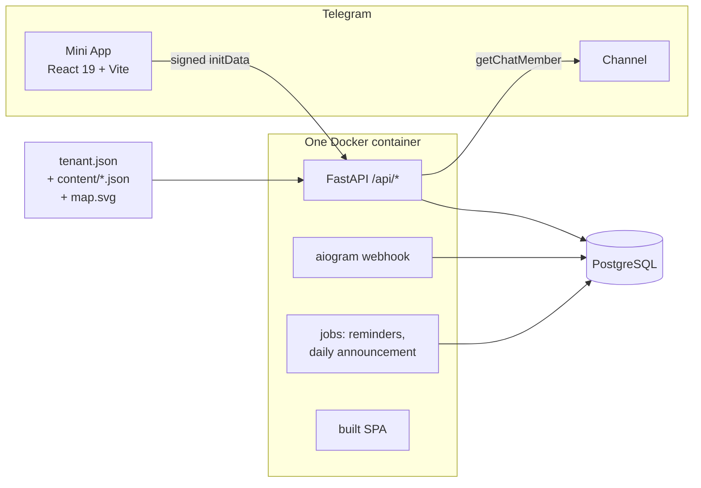

<div align="center">


# Fandom Kit

**A white-label Telegram Mini App for fandom channels: daily lore puzzles, a prediction league, an interactive world map and a "Which house are you?" quiz.**

English · [Русский](README.ru.md)

[](https://github.com/stella-nova-labs/fandom-kit/actions/workflows/tests.yml)




*Stars don't fear the dark — they're born in it.*

</div>

---

## What it is

Fandom Kit is the engine behind interactive apps that [Stella Nova Labs](https://github.com/stella-nova-labs) builds for authors of fandom Telegram channels. One deployment serves one channel; everything that belongs to the channel (name, texts, colors, characters, houses, map) is data, so a new channel is a config and a content folder, not a fork.

The repository runs out of the box on **the Northern Marches**, an original demo world (8 houses, 20 characters, 15 locations, its own hand-drawn map). It contains no third-party IP.

## Features

| Module | What players get |
|---|---|
| **Subscription gate** | The app opens only for members of the channel (`getChatMember`, 10-minute cache). If Telegram or the bot fails, the gate lets people in and the admin panel shows why. |
| **Character of the day** | A Wordle/Loldle-style puzzle: guess today's character; each guess shows a grid of attributes (house, region, gender, status, first appearance with ↑/↓, roles, alliance) in green / yellow / grey. Hints unlock after attempts 4 and 6. Streaks, stats, an attempt histogram and a spoiler-free emoji share. |
| **Crest of the day** | Guess the house by its crest, which appears from a blur and reveals its parts (field → ordinary → charge → words) with each wrong guess. |
| **Prediction league** | The channel author posts events (question, options, deadline, tag). Votes close on the server at the deadline; the vote split appears after it. Resolving pays points idempotently with a ×2 bonus for bold calls (< 20 % of voters). Weekly, season and all-time leaderboards; bot reminders an hour before the deadline. |
| **World map** | An original parchment SVG map with pinch-zoom, location cards (houses, characters), character journeys and a **spoiler slider** ("I've read/watched up to…"). |
| **Where is it?** | A mini GeoGuessr: read a clue, drop a pin, score by distance. 5 rounds, practice or a shared daily round with its own leaderboard. |
| **Which house are you?** | A 10–12 question onboarding quiz with weighted answers, the top match with percentages for the 3 closest houses, a canvas-rendered share card and "N % of the channel are House X" stats. |
| **Admin panel** | Inside the Mini App for `ADMIN_IDS`: create, close, resolve and cancel events; view and edit content (validated, stored as overrides); DAU, new players, daily completion, shares; bot/gate health. |
| **Bot** | `/start` with the Mini App button, a daily "new character" announcement, `/stop` and `/notify`. |

## Architecture



```
backend/app/
  api/        HTTP: authenticate (initData), gate, call game rules, return JSON
  game/       pure rules: schedule, comparison grid, crest stages, quiz scoring, bonus, geo scoring
  services/   gate, idempotent points under row locks, content overrides, analytics
  content/    pydantic schema of a fandom's content, validated with cross references on startup
  tenant.py   per-channel config (names, texts, colors, spoiler levels, tuning)
frontend/src/ screens, heraldry renderer, pan-zoom map, share card, Telegram WebApp wrapper
demo/         the Northern Marches: tenant.json, content/, mapspec.json
scripts/      check_public.sh, mapgen.py, screenshots.cjs
brand/        Stella Nova Labs brand kit
```

Engineering rules the code follows:

- **The server is the source of truth.** The answer of the day never reaches the client before the player's game ends; the client gets only comparison results. Deadlines, points and scores are computed on the server.
- **Idempotent points.** Every point goes through one function that inserts a `PointAward` with a unique `(source, ref, user)` under `SELECT … FOR UPDATE` on the player, so retries and double clicks never pay twice.
- **Stable days.** The daily answer is picked deterministically (a seeded permutation, no repeats until the pool is used up) and stored on first request, so content edits don't rewrite past days.
- **Fail fast on content.** Content and tenant files are validated on startup, including references (a location pointing at a missing house stops the deploy).
- **Pure game rules.** `game/` has no database and no HTTP; it is covered by unit tests.

## Run it locally

Requirements: Python 3.12+, Node.js 22+.

```bash
# backend
cd backend
python -m venv .venv && source .venv/bin/activate
pip install -r requirements-dev.txt
cp .env.example .env            # DEV_AUTH=1: open the app without Telegram
uvicorn app.main:app --reload --port 8000

# frontend (second terminal)
cd frontend
npm ci
npm run dev                     # http://localhost:5173/?dev=1
```

`?dev=<id>` signs you in as a local user with that Telegram id (accepted only with `DEV_AUTH=1`). `ADMIN_IDS=1` in `.env.example` makes user 1 an admin.

### Checks

```bash
cd backend && pytest -q                       # game rules, API, gate, idempotency, jobs
cd frontend && npx oxlint --deny-warnings && npm run build
./scripts/check_public.sh                     # stop list + secret scan (also a pre-push hook)
```

Enable the pre-push hook once per clone: `git config core.hooksPath .githooks`.

## Deploy for your channel (white-label in an hour)

A deployment is the engine plus **your** `tenant.json` and `content/`. The recommended layout is a private repository with this engine as a git submodule:

```
your-channel-app/          (private)
  engine/                  ← git submodule: stella-nova-labs/fandom-kit
  tenant.json              ← channel, names, texts, colors, spoiler levels
  content/                 ← characters, houses, locations, geo clues, quiz, events, map.svg
  Dockerfile               ← builds engine/ and copies tenant.json + content/
  railway.json
```

1. **Content.** Copy `demo/` and replace it with your world. The schema is in `backend/app/content/schema.py`; run `pytest` with `CONTENT_DIR=… TENANT_FILE=…` to validate. Mark facts you're unsure of with `"verify": true`; the admin panel highlights them.
2. **Map.** Describe coastlines, mountains, forests, rivers and labels in a small JSON and run `python scripts/mapgen.py mapspec.json content/map.svg`. Location `x/y` are in the same units.
3. **Crests.** Houses describe their crest as a blazon (`field`, `division`, `ordinary`, `charge`, tinctures); the frontend renders it as an original SVG. See `frontend/src/lib/heraldry.ts` for available charges.
4. **Bot.** In [@BotFather](https://t.me/BotFather): `/newbot` → copy the token; `/newapp` (or *Bot Settings → Configure Mini App*) → set the URL to your Railway domain; `/setuserpic` with `brand/stella-nova-icon-512.png` or your own.
5. **Add the bot as an administrator of the channel.** Without it Telegram does not return membership and the gate can't check subscriptions (the admin panel shows a red status in that case).
6. **Railway.** New project → *Deploy from GitHub repo* (submodules are fetched; for a private tenant repo with a public engine submodule no extra token is needed) → add a PostgreSQL service → set variables:

| Variable | Value |
|---|---|
| `BOT_TOKEN` | token from @BotFather |
| `BOT_MODE` | `webhook` |
| `WEBAPP_URL` | `https://<service>.up.railway.app` |
| `WEBHOOK_SECRET` | any random string (`openssl rand -hex 24`) |
| `DATABASE_URL` | `${{Postgres.DATABASE_URL}}` |
| `ADMIN_IDS` | comma-separated Telegram ids of the admins |
| `TENANT_FILE`, `CONTENT_DIR` | set by the tenant Dockerfile |

The container runs `alembic upgrade head` on start; health check: `/api/health`.

## Brand

The Stella Nova Labs kit (logo, mark, bot icon, palette, fonts and usage rules) is in [`brand/`](brand/README.md). Tenants may override the two accent colors; the splash screen, the footer and the corner mark on share cards stay.

## Legal

The engine and the demo world are MIT-licensed and original. A tenant built on an existing franchise is an unofficial fan project and shows a disclaimer on its About screen. Out of the box the engine draws crests from written blazons and maps with its own generator; a tenant may instead add its own images (`crest.image` per house, any image type as `map.file`). **The tenant is responsible for having the rights to every image it adds.** No paid features are built in.

### Custom images

- Crest: put the file in `content/heraldry/images/` and add `"image": "heraldry/images/<file>.png"` to the house's `crest`. The blazon stays as data (the daily crest puzzle still reveals it part by part); the image is shown everywhere else.
- Map: set `"file"` in `content/locations.json → map` to any `.svg`, `.png`, `.jpg` or `.webp`, and keep `width`/`height` equal to the image's coordinate system, so location `x/y` stay correct.

## Contributing

See [CONTRIBUTING.md](CONTRIBUTING.md). Issues and pull requests are welcome.

---

<div align="center"><sub>Made by <b>Stella Nova Labs</b> · Coburg, Germany</sub></div>
