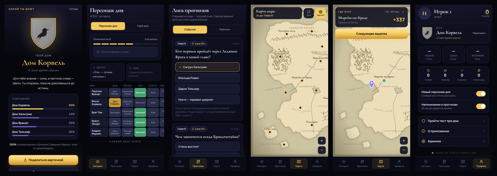

<div align="center">


# Fandom Kit

**White-label Telegram Mini App для фандомных каналов: ежедневные угадайки по лору, лига прогнозов, интерактивная карта мира и тест «Какой ты дом?».**

[English](README.md) · Русский



*Stars don't fear the dark — they're born in it.*

</div>

---

## Что это

Fandom Kit — движок интерактивных приложений, которые [Stella Nova Labs](https://github.com/stella-nova-labs) делает для авторов фандомных Telegram-каналов. Один деплой обслуживает один канал. Всё, что относится к каналу (название, тексты, цвета, персонажи, дома, карта), лежит в данных, поэтому новый канал — это конфиг и папка контента, а не форк.

Репозиторий запускается из коробки на **Северных Марках** — оригинальном демо-мире: 8 домов, 20 персонажей, 15 локаций, своя рисованная карта. Чужой интеллектуальной собственности здесь нет.

## Модули

- **Подписочный гейт.** Приложение открывается только подписчикам канала (`getChatMember`, кэш 10 минут). При сбое Telegram или если бот не админ, гейт пропускает, а причина видна в админке.
- **Персонаж дня.** Угадайка в стиле Wordle/Loldle: сетка атрибутов (дом, регион, пол, статус, первое появление ↑/↓, роль, союз) зелёным, жёлтым и серым. Подсказки открываются после 4-й и 6-й попытки. Есть серии, статистика и шеринг эмодзи-сеткой без спойлеров.
- **Герб дня.** Герб проявляется из размытия, и с каждой ошибкой открываются его части.
- **Лига прогнозов.** События от автора канала, дедлайн проверяет сервер. Распределение голосов видно после дедлайна, очки начисляются идемпотентно, смелый прогноз (меньше 20 % голосов) даёт ×2. Рейтинги за неделю, сезон и всё время, напоминания ботом.
- **Карта мира.** Своя пергаментная SVG-карта с зумом пальцами, карточками мест, путями персонажей и ползунком «без спойлеров».
- **«Где это?»** Мини-геогессер: зацепка, точка на карте, очки по расстоянию. 5 раундов, тренировка или общий раунд дня с рейтингом.
- **«Какой ты дом?»** Онбординг-тест с весами, процентом совпадения с ближайшими домами, карточкой для шеринга (canvas) и статистикой канала.
- **Админка в Mini App.** События, правка контента, статистика (DAU, новые игроки, прохождение дейли, шеринги), статус бота и гейта.

## Локальный запуск

```bash
cd backend && python -m venv .venv && source .venv/bin/activate
pip install -r requirements-dev.txt && cp .env.example .env
uvicorn app.main:app --reload --port 8000
# второй терминал
cd frontend && npm ci && npm run dev    # http://localhost:5173/?dev=1
```

Проверки: `pytest -q`, `npx oxlint --deny-warnings`, `npm run build`, `./scripts/check_public.sh`.

## Как развернуть для своего канала

1. Создайте приватный репозиторий, подключите движок сабмодулем `engine/` и положите рядом `tenant.json` и `content/` (образец — `demo/`).
2. Нарисуйте карту: `python engine/scripts/mapgen.py mapspec.json content/map.svg`.
3. Гербы описываются геральдически (поле, деление, фигура, тинктуры) и рисуются движком как оригинальные SVG.
4. В @BotFather создайте бота (`/newbot`) и Mini App (`/newapp`) с URL вашего домена Railway.
5. **Добавьте бота администратором канала**, иначе Telegram не отдаёт статус подписки.
6. На Railway: деплой из GitHub, сервис PostgreSQL, переменные `BOT_TOKEN`, `BOT_MODE=webhook`, `WEBAPP_URL`, `WEBHOOK_SECRET`, `DATABASE_URL=${{Postgres.DATABASE_URL}}`, `ADMIN_IDS`.

Подробности — в [README.md](README.md#deploy-for-your-channel-white-label-in-an-hour).

## Юридическое

Движок и демо-мир распространяются по лицензии MIT и полностью оригинальны. Тенант по существующей вселенной — неофициальный фан-проект: имена и факты используются как текст, гербы и карты рисуются заново, кадров, логотипов, шрифтов, музыки и лиц актёров нет, на экране «О приложении» есть дисклеймер. Платных функций нет.

---

<div align="center"><sub>Made by <b>Stella Nova Labs</b> · Кобург, Германия</sub></div>
